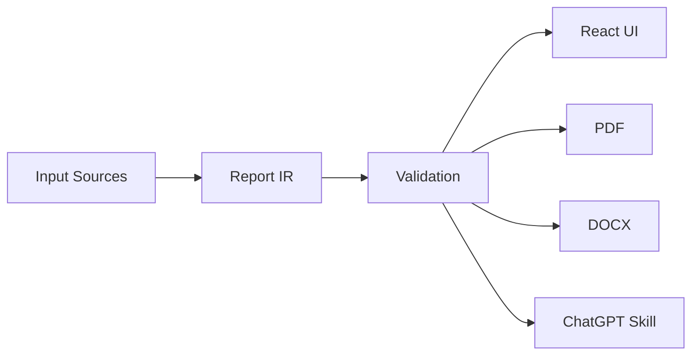

<div align="center">


# RISHEH Visual Reporting Design System
### سیستم طراحی گزارش‌دهی بصری ریشه

**Semantic-first · Evidence-based · RTL-aware · Multi-format**

[📖 آموزش تصویری فارسی](docs/LEARNING_GUIDE_FA.md) · [Illustrated Guide](docs/LEARNING_GUIDE_EN.md) · [فارسی](#فارسی) · [English](#english) · [Architecture](docs/ARCHITECTURE.md) · [Glossary](docs/GLOSSARY_FA.md) · [Skill](skills/risheh-visual-reporting/SKILL.md)

</div>

## فارسی

**RVRDS** زیرساخت گزارش‌دهی بصری ریشه است. یک مدل میانی مشترک (Report IR) محتوا را از نحوه نمایش جدا می‌کند تا گزارش در React، PDF، Word و ChatGPT ساختاری هماهنگ داشته باشد.

### قابلیت‌ها
- مدل داده TypeScript و اعتبارسنجی گزارش و ارجاعات منابع
- کارت KPI، جدول، نمودار میله‌ای، خطی و دایره‌ای، تایم‌لاین و فلو
- نمایش React با پشتیبانی راست‌به‌چپ و داده جدولی جایگزین نمودار
- خروجی اولیه PDF و DOCX
- Design Tokens، فرهنگ اصطلاحات، هشت قالب و Skill

### آموزش تصویری قدم‌به‌قدم


**[شروع آموزش کامل فارسی](docs/LEARNING_GUIDE_FA.md)** · [چک‌لیست انتشار](docs/RELEASE_CHECKLIST.md)

### معماری تصویری



### نصب و آزمون

```bash
npm install
npm run check
npm run build
```

[نمونه گزارش](examples/sample-report.json) · [توکن‌های طراحی](tokens/tokens.json) · [قواعد انتخاب نمودار](docs/VISUALIZATION_RULES.md)

### فازهای ۴ تا ۶

- خروجی نمودارها به‌صورت تصویر در PDF و DOCX (نیازمند آزمون اجرایی)
- تنظیم فونت Unicode برای PDF فارسی با گزینه `fontPath`
- دمو React با Vite و آزمون Playwright برای دسکتاپ و موبایل
- گردش کار CI برای Build، تست واحد و آزمون مرورگر

**[راهنمای اجرا و کنترل کیفیت فازهای ۴ تا ۶](docs/PHASES_4_6.md)**

### محدودیت‌های فعلی
**این نسخه Foundation/MVP است و هنوز Production-ready تأیید نشده.** PDF فعلاً نمودارها را به‌صورت داده متنی حفظ می‌کند؛ شکل‌دهی فارسی و فونت RTL در PDF باید تکمیل و تست شود. CI و اجرای تست‌ها هنوز تأیید نشده‌اند. هیچ عدد نمایشی نباید به‌عنوان داده واقعی استفاده شود.

---

## English

**RVRDS** is an evolving, semantic-first visual reporting toolkit. A shared Report Intermediate Representation separates content from platform-specific rendering, making reports easier to validate and reuse across React, PDF, DOCX and ChatGPT.

### Features
- Typed report contract and validation with source reference checks
- React KPI cards, tables, bar/line/pie charts, timelines and flows
- RTL-aware browser rendering and tabular chart fallbacks
- Baseline PDF and DOCX export adapters
- Design tokens, bilingual glossary, eight report templates and reusable Skill

### Illustrated learning


Read the [step-by-step English guide](docs/LEARNING_GUIDE_EN.md) and the [release checklist](docs/RELEASE_CHECKLIST.md).

### Quick start

```bash
npm install
npm run check
npm run build
```

Explore the [architecture](docs/ARCHITECTURE.md), [visualization rules](docs/VISUALIZATION_RULES.md), [templates](docs/TEMPLATES.md) and [example report](examples/sample-report.json).

### Phases 4–6

- Rasterized chart images in PDF/DOCX adapters (runtime verification pending)
- Explicit Unicode font path for Persian PDF exports
- Vite/React demo with Playwright desktop and mobile checks
- CI jobs for typecheck, unit tests, build and browser QA

[Phases 4–6 implementation and QA instructions](docs/PHASES_4_6.md)

### Project status
**Foundation/MVP, not production-certified.** Persian PDF shaping/font embedding, richer document charts, browser visual regression and verified CI results are pending. Demo values are explicitly synthetic.

---

<div align="center"><strong>RISHEH Digital · Clarity through evidence and visual structure.</strong></div>
