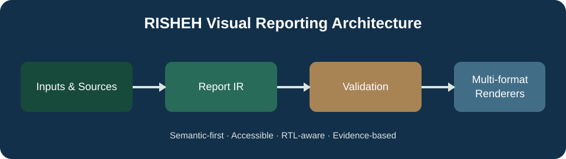
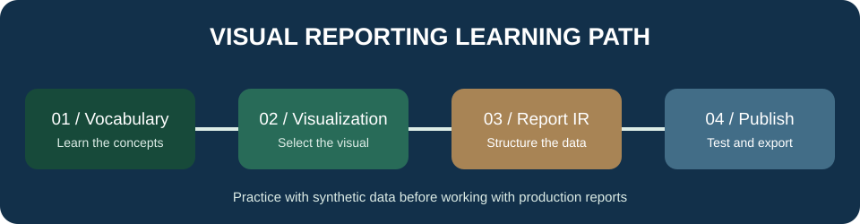
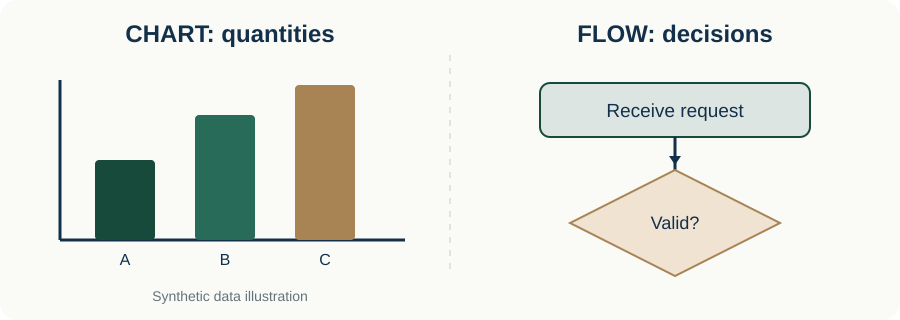
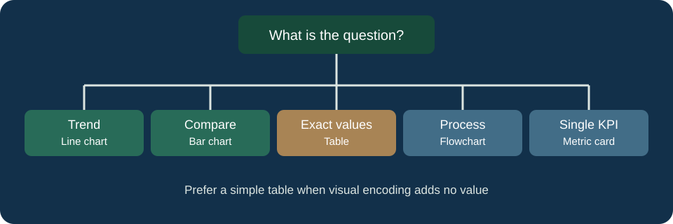
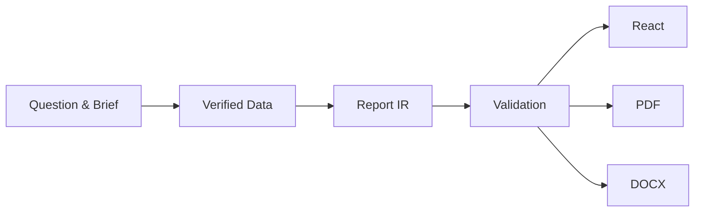

<div align="center">



# RISHEH Visual Reporting Design System
### مرجع آموزشی و ابزار ساخت گزارش بصری برای تیم ریشه

**Learn the language · Design with evidence · Build reusable reports**

[🚀 از اینجا شروع کنید](docs/START_HERE_FA.md) · [📚 آکادمی فارسی](docs/ACADEMY_FA.md) · [📖 واژه‌نامه تشریحی](docs/GLOSSARY_FA.md) · [🧪 تمرین با پاسخ](docs/WORKBOOK_FA.md) · [English guide](docs/LEARNING_GUIDE_EN.md)

</div>

> **برای تمام اعضای تیم:** برای خواندن بخش آموزشی هیچ دانش برنامه‌نویسی لازم نیست. تمام نمونه‌های آموزشی ساختگی هستند و هیچ اطلاعات مشتری در آن‌ها استفاده نشده است.

## نمونه‌های تصویری واقعی‌نما

**[اطلس تصویری ۲۶ اصطلاح با نمونه‌های قابل مشاهده](docs/VISUAL_ATLAS_FA.md)** · [فرهنگ تصویری اصطلاحات](docs/GLOSSARY_FA.md) · [ده درس تشریحی](docs/ACADEMY_FA.md)

در اطلس، نمونه خودِ Wireframe، Mockup، Prototype، Dashboard، نمودارها و سایر اصطلاحات نمایش داده شده است؛ نه صرفاً جعبه‌های عنوان‌دار.

## این مخزن چه کمکی می‌کند؟

این مخزن دو هدف دارد: **آموزش دقیق زبان طراحی و گزارش‌دهی** و **ارائه کد قابل استفاده مجدد** برای تولید گزارش در React، PDF و Word. با آن یاد می‌گیریم چه زمانی بریف، بلوپرینت، فلوچارت، نمودار، وایرفریم یا موکاپ لازم است؛ سپس می‌توانیم در پروژه‌های مناسب از ساختار داده و رندرکننده استفاده کنیم.

## نقشه راه اعضای تیم

| نقش | مسیر یادگیری | خروجی |
|---|---|---|
| تازه‌وارد، مدیر پروژه، محتوا | [شروع](docs/START_HERE_FA.md) → [دوره پایه](docs/ACADEMY_FA.md) | بریف و روایت گزارش |
| UI/UX و گرافیک | [دوره پایه](docs/ACADEMY_FA.md) → [قواعد نمودار](docs/VISUALIZATION_RULES.md) → [تمرین](docs/WORKBOOK_FA.md) | انتخاب نمایش و چیدمان با دلیل |
| Frontend و Full-stack | [راهنمای توسعه‌دهنده](docs/DEVELOPER_GUIDE_FA.md) → [نمونه JSON](examples/sample-report.json) | پیاده‌سازی گزارش در پروژه |
| QA و تحویل | [راهنمای کنترل کیفیت](docs/QA_HANDBOOK_FA.md) | تست و گزارش باگ قابل بازتولید |

## آموزش با تصویر و مثال







**[دوره کامل تشریحی با مثال آوا (محصول خیالی)](docs/ACADEMY_FA.md)**

**نسخه تصویری جدید:** هر ۱۰ درس یک تصویر اختصاصی SVG دارد و توضیح‌ها به‌صورت روایت پیوسته، با مثال ملموس و تمرین نوشته شده‌اند. تصاویر داخل مخزن نگهداری می‌شوند و بدون سرویس خارجی قابل مشاهده‌اند.

## کاربرد در پروژه‌ها

- گزارش عملکرد و تحلیل محصول: KPI، جدول و نمودار.
- مستندسازی مسیر کاربر و فرایند: Flowchart و Timeline.
- طراحی تجربه: Brief، Blueprint، Wireframe، Mockup و Prototype (بخش آموزشی؛ همه این‌ها کامپوننت کدنویسی‌شده در این بسته نیستند).
- گزارش‌های React و خروجی PDF/DOCX: استفاده از مدل Report IR و رندرکننده‌های مخزن، پس از آزمون در پروژه مقصد.

### مسیر فنی کوتاه

```bash
npm install
npm run check
npm run build
npm run demo
```

[راهنمای استفاده در پروژه](docs/DEVELOPER_GUIDE_FA.md) · [مدل داده](src/core.ts) · [نمونه آموزشی](examples/sample-report.json) · [Skill](skills/risheh-visual-reporting/SKILL.md)



## استانداردهای تیم

**داده معتبر، روایت روشن، نمایش مناسب، RTL صحیح، دسترس‌پذیری و کنترل کیفیت واقعی.** از تصاویر دست‌نویس، حاشیه‌نویسی غیرحرفه‌ای و اعداد ساختگی بدون برچسب استفاده نکنید.

## تحویل و آزمون نهایی

[راهنمای تحویل و معیارهای بستن پروژه](docs/FINAL_RELEASE_HANDOFF_FA.md) · اجرای بررسی ساختاری: `npm run qa:education` · تولید ۷۸ اسکرین‌شات: `npm run qa:visual` · بررسی یکپارچه: `npm run qa:release`.

**وضعیت:** ابزارهای QA آماده‌اند؛ تأیید نهایی بصری و Production تا اجرای واقعی آزمون‌ها و بررسی خروجی‌ها مشروط است.

## کنترل کیفیت آموزش

[گزارش مستند QA آموزش](docs/EDUCATION_QA_REPORT_FA.md) · آزمون آفلاین: `node scripts/education-qa.mjs`. بازبینی واقعی تمام تصاویر در موبایل و دسکتاپ هنوز الزامی است.

## وضعیت فنی و انتشار

**نسخه هنوز Production-ready تأیید نشده است.** وجود کد خروجی PDF/DOCX و تست‌های مرورگر به معنی موفقیت آن‌ها نیست. پیش از استفاده در پروژه مشتری، آزمون Build، مرورگر و کیفیت واقعی PDF فارسی لازم است. [گزارش ممیزی فنی](docs/FINAL_AUDIT_FA.md) و [دفترچه QA](docs/QA_HANDBOOK_FA.md) برای مسئول فنی هستند؛ نقطه شروع آموزشی تیم نیستند.

---

## English

**RISHEH Visual Reporting Design System** is both a learning reference for visual communication and a TypeScript/React reporting toolkit. The learning track requires no programming experience; implementation requires integration and verification.

**Start:** [English illustrated guide](docs/LEARNING_GUIDE_EN.md) · [Architecture](docs/ARCHITECTURE.md) · [Developer guide (FA)](docs/DEVELOPER_GUIDE_FA.md) · [QA handbook (FA)](docs/QA_HANDBOOK_FA.md).

**Status:** Educational documentation is available. Code paths for React, PDF and DOCX exist but have not been certified for production deployment. Do not treat sample data as customer data.

---

<div align="center"><strong>RISHEH Digital · Explain clearly. Design deliberately. Verify before delivery.</strong></div>
