# آکادمی تصویری طراحی و گزارش‌دهی ریشه

این راهنما برای اعضای فنی و غیرفنی تیم نوشته شده است. قرار نیست اصطلاحات را حفظ کنیم؛ می‌خواهیم وقتی در جلسه‌ای گفته می‌شود «بریف»، «بلوپرینت» یا «چارت»، همه دقیقاً بدانند منظور چیست و چه خروجی باید تولید شود. برای ملموس‌شدن موضوع، در تمام درس‌ها از محصول **کاملاً خیالی آوا** استفاده می‌کنیم. هیچ‌کدام از داده‌ها به پروژه یا مشتری واقعی مربوط نیستند.

هر فصل با یک موقعیت واقعی‌نما شروع می‌شود، مفهوم را در متن توضیح می‌دهد، یک تصویر اختصاصی دارد و در پایان یک تمرین کوتاه پیشنهاد می‌کند. تصاویر این نسخه نمونه‌های مشخص از خودِ خروجی‌ها هستند: صفحه وایرفریم، موکاپ، داشبورد، نمودار، فلوچارت و دیگر نمونه‌ها را می‌بینی. همه نمونه‌ها برای محصول خیالی آوا طراحی شده‌اند و اسکرین‌شات مشتری واقعی نیستند. برچسب‌های کوتاه انگلیسی در SVG برای سازگاری نمایش استفاده شده‌اند و توضیح فارسی در متن آمده است.

**پیشنهاد مطالعه تصویری:** [اطلس نمونه‌های واقعی‌نما برای همه اصطلاحات](VISUAL_ATLAS_FA.md) را کنار درس‌ها باز کن و تفاوت خروجی‌ها را مستقیماً مقایسه کن.

**مدت پیشنهادی مطالعه:** دو تا سه ساعت، همراه با انجام تمرین‌ها.

## درس 1 — بریف؛ قبل از طراحی بدانیم چه مسئله‌ای داریم

### راهنمای خواندن تصاویر این درس

در تصویر بریف، به چهار ردیف داخل سند توجه کن. «مخاطب» مشخص می‌کند چه کسی گزارش را می‌خواند؛ «سؤال» می‌گوید قرار است چه چیزی را بفهمیم؛ «شواهد» داده لازم را تعیین می‌کند و «خروجی» شکل تحویل را روشن می‌کند. این یک نمونه از خود سند بریف است، نه فقط فهرست کلمات مرتبط با بریف.

**یک نکته برای استفاده در پروژه:** وقتی کسی می‌گوید «یک صفحه جذاب طراحی کن»، قبل از انتخاب رنگ از او بپرس: «این صفحه قرار است به کدام سؤال جواب بدهد؟»

فرض کن یکی از اعضای تیم می‌گوید «برای محصول آوا یک گزارش جذاب درست کنیم». این جمله هنوز برای شروع طراحی کافی نیست. نمی‌دانیم چه کسی قرار است گزارش را بخواند، چه تصمیمی باید بگیرد و اصلاً کدام داده برای او مهم است. **بریف (Brief)** کمک می‌کند این ابهام‌ها قبل از صرف زمان روی رنگ و چیدمان برطرف شوند.

در مثال کاملاً ساختگی «آوا»، مدیر محصول می‌خواهد بفهمد آیا درخواست‌های کاربران در سه ماه اخیر افزایش یافته‌اند. اکنون می‌توانیم مسئله را دقیق‌تر بنویسیم: مخاطب مدیر محصول است، سؤال تغییر تعداد درخواست‌ها در زمان است، داده لازم شمار ماهانه درخواست‌هاست و خروجی باید در موبایل هم خوانا باشد. این متن، یک بریف واقعی‌تر از «داشبورد شیک» است.

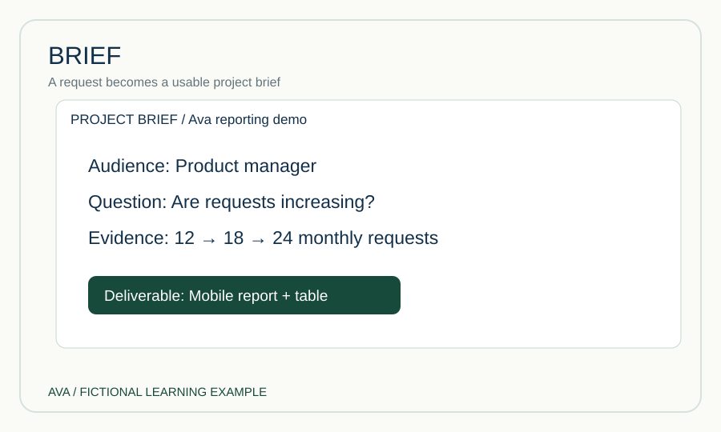

در تصویر زیر چهار جزء کنار هم قرار گرفته‌اند: مخاطب، تصمیم، داده و خروجی. ارتباط آن‌ها مهم است؛ چون اگر داده‌ای داشته باشیم که به تصمیم مخاطب ربطی ندارد، حتی زیباترین نمودار هم کمکی نمی‌کند. بریف با وایرفریم فرق دارد: بریف توضیح می‌دهد **چرا** چیزی را می‌سازیم؛ وایرفریم بعداً نشان می‌دهد **کجا** قرار می‌گیرد.

**تمرین کوتاه:** برای گزارشی درباره رضایت کاربران، یک جمله درباره مخاطب و یک جمله درباره تصمیمی که باید بگیرد بنویس. تا زمانی که این دو روشن نشده‌اند، نمودار انتخاب نکن.

---

## درس 2 — بلوپرینت؛ نقشه ارتباط اجزای کار

### راهنمای خواندن تصاویر این درس

در تصویر Blueprint سه ردیف را از بالا به پایین دنبال کن: کار کاربر، آنچه کاربر در رابط می‌بیند و آنچه پشت‌صحنه اتفاق می‌افتد. ستون‌های کنار هم نشان می‌دهند هر مرحله در تجربه کاربر چه معادل فنی‌ای دارد. این نوع نقشه کمک می‌کند بفهمیم اگر فرم خطا داشت، کدام بخش باید بررسی شود.

**یک نکته برای استفاده در پروژه:** برای یک فرایند ساده ثبت‌نام، سه ردیف «کاربر»، «صفحه» و «سیستم» را رسم کن و ببین در هر مرحله چه رخ می‌دهد.

بعد از روشن‌شدن مسئله، باید بدانیم اطلاعات از کجا می‌آیند و چه مراحلی را طی می‌کنند. اینجا **بلوپرینت (Blueprint)** به کار می‌آید. بلوپرینت یک نقشه کلان است که اجزا و ارتباط آن‌ها را نمایش می‌دهد؛ مثلاً فایل داده وارد سیستم می‌شود، صحت آن بررسی می‌شود، به مدل گزارش تبدیل می‌شود و سپس خروجی وب یا سند ساخته می‌شود.

تصویر زیر این مسیر را به چهار ایستگاه ساده تقسیم کرده است. هر ایستگاه مسئولیتی متفاوت دارد. اگر داده ورودی غلط باشد، مشکل را نباید با تغییر رنگ نمودار پنهان کرد؛ باید به مرحله ورودی یا اعتبارسنجی برگردیم. همین نگاه باعث می‌شود اعضای طراحی و توسعه درباره جای هر مسئله زبان مشترکی داشته باشند.

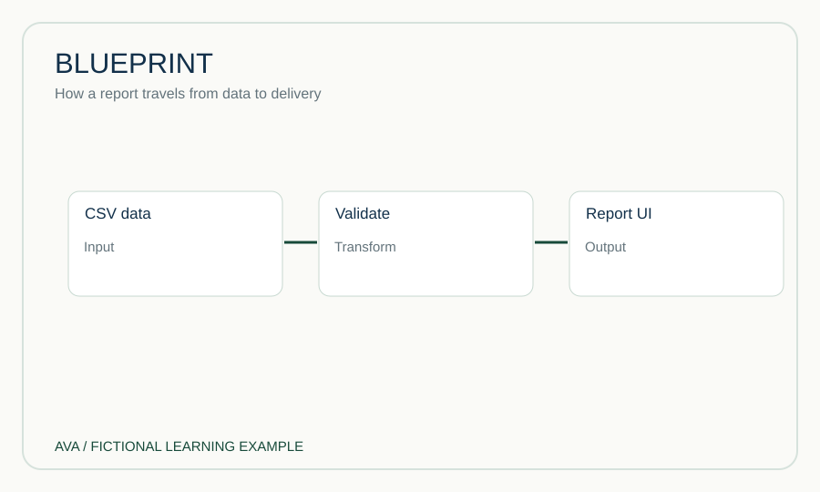

بلوپرینت الزاماً نقشه ظاهر صفحه نیست. ممکن است برای معماری نرم‌افزار، مسیر خدمت‌رسانی یا روند تولید یک گزارش ساخته شود. وقتی می‌خواهیم جای دکمه و جدول را مشخص کنیم، به وایرفریم نزدیک شده‌ایم؛ اما وقتی می‌خواهیم بفهمیم اطلاعات چگونه از پایگاه داده به گزارش می‌رسند، بلوپرینت مناسب‌تر است.

**تمرین کوتاه:** مسیر «ثبت درخواست → بررسی اطلاعات → تأیید → اطلاع‌رسانی» را در چهار جعبه بنویس و بگو کدام مرحله ممکن است به مسیر خطا نیاز داشته باشد.

---

## درس 3 — چارت، گراف، دیاگرام و فلوچارت؛ چهار مفهوم متفاوت

### راهنمای خواندن تصاویر این درس

تصویر Chart یک نمودار واقعی از سه ماه را نشان می‌دهد: ستون فروردین ۱۲، اردیبهشت ۱۸ و خرداد ۲۴. تصویر Flowchart همان داده را نمایش نمی‌دهد؛ در آن فرم ثبت می‌شود، تصمیم «معتبر است؟» گرفته می‌شود و مسیر بله و خیر از هم جدا می‌شوند. به تفاوت «مقدار» و «تصمیم» دقت کن.

**یک نکته برای استفاده در پروژه:** اگر سؤال «چند مورد؟» است به عدد و نمودار فکر کن؛ اگر سؤال «بعد چه می‌شود؟» است به فلوچارت.

گاهی همه تصویرهای توضیحی را «چارت» می‌نامیم؛ اما این واژه‌ها یک معنا ندارند. **چارت (Chart)** معمولاً برای نمایش داده به کار می‌رود. وقتی می‌گوییم درخواست‌ها در سه ماه به‌ترتیب ۱۲، ۱۸ و ۲۴ بوده‌اند، نمودار میله‌ای یا خطی می‌تواند مقدارها را نشان دهد. این اعداد در مثال ما ساختگی‌اند.

**دیاگرام (Diagram)** دامنه وسیع‌تری دارد. می‌توانیم بدون هیچ عددی نشان دهیم که رابط کاربری به API متصل است و API از پایگاه داده استفاده می‌کند. **فلوچارت (Flowchart)** نوع خاصی از دیاگرام است که مسیر انجام کار و نقطه‌های تصمیم را نمایش می‌دهد؛ مثلاً «اطلاعات کامل است؟» دو شاخه بله و خیر دارد. **گراف (Graph)** هم بسته به زمینه ممکن است نمودار داده یا شبکه‌ای از گره‌ها و ارتباط‌ها باشد.

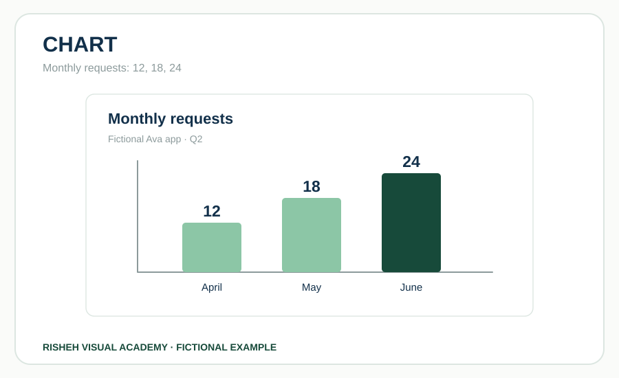

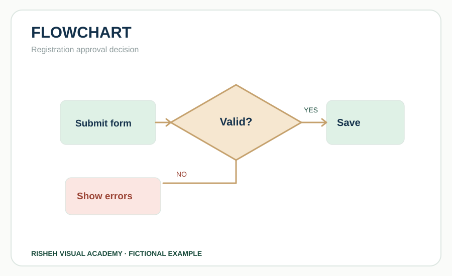

در تصویر، ستون‌های عددی در سمت چپ با مسیر جهت‌دار سمت راست مقایسه شده‌اند. اولی درباره **مقدار** حرف می‌زند و دومی درباره **رابطه یا حرکت**. اگر سؤال ما این باشد که «چند درخواست ثبت شد؟»، فلوچارت پاسخ نمی‌دهد. اگر سؤال این باشد که «پس از ثبت چه اتفاقی می‌افتد؟»، نمودار میله‌ای پاسخ نمی‌دهد.

**تمرین کوتاه:** برای «تعداد خطا در هر روز» و «مسیر رسیدگی به خطا» دو نوع تصویر متفاوت انتخاب کن و دلیلش را توضیح بده.

---

## درس 4 — متریک، KPI، داشبورد و اسکورکارت؛ معنی پشت اعداد

### راهنمای خواندن تصاویر این درس

در نمونه KPI، عدد ۸۰ درصد بدون هدف نمایش داده نشده است: هدف ۹۰ درصد در کنار آن آمده تا فاصله روشن شود. در تصویر Scorecard چند معیار به همراه ستون‌های هدف و عملکرد واقعی دیده می‌شوند. داشبورد نیز چند شاخص و نمودار را کنار هم جمع می‌کند. تفاوت را در سطح اطلاعات هر تصویر ببین.

**یک نکته برای استفاده در پروژه:** یک عدد بدون واحد و بازه زمانی را در جلسه گزارش نکن؛ ابتدا مشخص کن «چه چیزی، چه زمانی و در مقایسه با چه هدفی».

عدد ۲۴ به‌تنهایی اطلاعات چندانی نمی‌دهد. باید بدانیم ۲۴ **چه چیزی**، در **چه زمانی** و نسبت به **چه هدفی** است. **متریک (Metric)** یک مقدار قابل اندازه‌گیری است؛ مثلاً ۲۴ درخواست ثبت‌شده در خرداد. اما **KPI** یا شاخص کلیدی عملکرد زمانی معنا پیدا می‌کند که آن مقدار مستقیماً با هدف کسب‌وکار ارتباط داشته باشد.

فرض کنیم هدف ساختگی ما ۳۰ درخواست در ماه بوده و ۲۴ درخواست ثبت شده است. در این حالت ۸۰ درصد هدف محقق شده است. **اسکورکارت (Scorecard)** می‌تواند عملکرد، هدف و اختلاف را کنار هم نشان دهد. **داشبورد (Dashboard)** ممکن است همین شاخص را در کنار روند سه‌ماهه، وضعیت درخواست‌ها و هشدارهای مهم نمایش دهد.

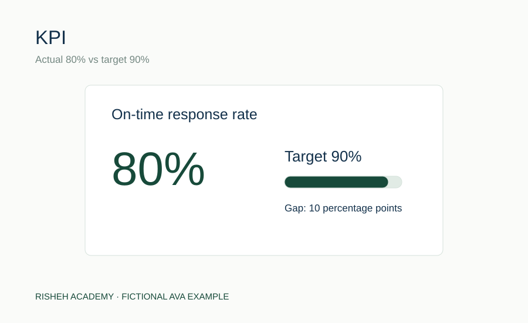

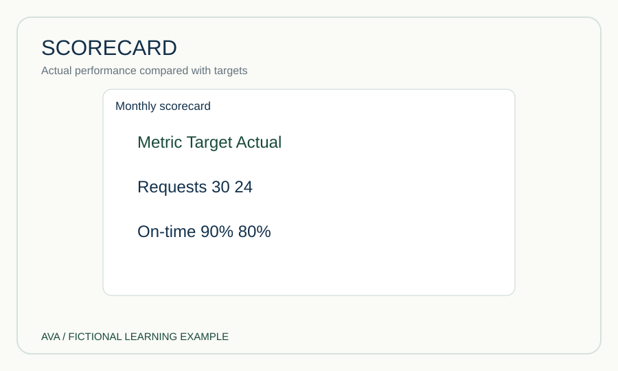

حلقه ۸۰ درصدی تصویر برای توضیح نسبت عملکرد به هدف است، نه برای اینکه هر درصدی را به شکل دایره نشان دهیم. باید کنار آن بنویسیم مبنای محاسبه چیست. اگر هدف یا بازه زمانی نامشخص باشد، مخاطب ممکن است برداشت اشتباه کند. بنابراین طراحی شاخص بدون تعریف و منبع، فقط تزئین عدد است.

**تمرین کوتاه:** آیا «تعداد بازدید صفحه» همیشه KPI است؟ نه؛ فقط وقتی به هدف مشخص و قابل سنجش مرتبط باشد. یک مثال از چنین هدفی بنویس.

---

## درس 5 — وایرفریم، موکاپ و پروتوتایپ؛ از اسکلت تا رفتار

### راهنمای خواندن تصاویر این درس

سه تصویر را پشت سر هم مقایسه کن. در Wireframe جای منو، کارت‌ها و نمودار مشخص است ولی رنگ‌ها خنثی‌اند. در Mockup دقیقاً همان چیدمان با رنگ، تایپوگرافی و داده نمونه طراحی شده است. در Prototype همان صفحه یک فیلتر انتخاب‌شده و پیام تغییر وضعیت دارد. توجه کن تصویر ثابت Prototype فقط یک حالت تعاملی را نشان می‌دهد؛ برای آزمون رفتار واقعی، نمونه قابل کلیک لازم است.

**یک نکته برای استفاده در پروژه:** در بررسی تیمی ابتدا چیدمان را با Wireframe تأیید کن، سپس ظاهر را با Mockup و رفتار را با Prototype آزمایش کن.

برای طراحی یک صفحه، معمولاً چند نوع خروجی می‌سازیم که هرکدام پرسش متفاوتی را پاسخ می‌دهند. **وایرفریم (Wireframe)** شبیه نقشه ساده چیدمان است. در این مرحله مشخص می‌کنیم عنوان، فیلتر، نمودار و جدول کجا باشند و کاربر چه چیزی را اول ببیند. لازم نیست همه رنگ‌ها و فونت‌ها نهایی باشند.

**موکاپ (Mockup)** به ظاهر واقعی محصول نزدیک‌تر می‌شود. رنگ برند، فاصله‌ها، تایپوگرافی، آیکون و محتوای نمونه در آن دیده می‌شوند. اما یک تصویر زیبا داخل قاب لپ‌تاپ لزوماً تعاملی نیست. **پروتوتایپ (Prototype)** به ما اجازه می‌دهد رفتار را آزمایش کنیم؛ مثلاً با انتخاب یک فیلتر، وضعیت صفحه تغییر کند یا کاربر بتواند از فهرست به جزئیات برود.

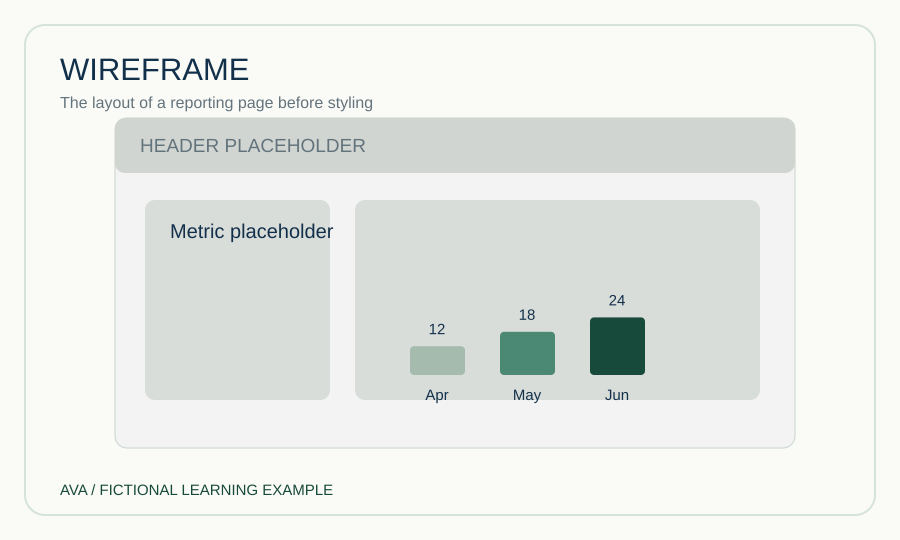

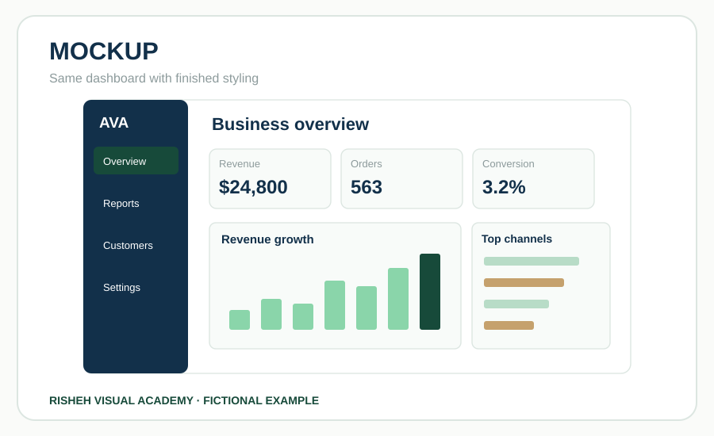

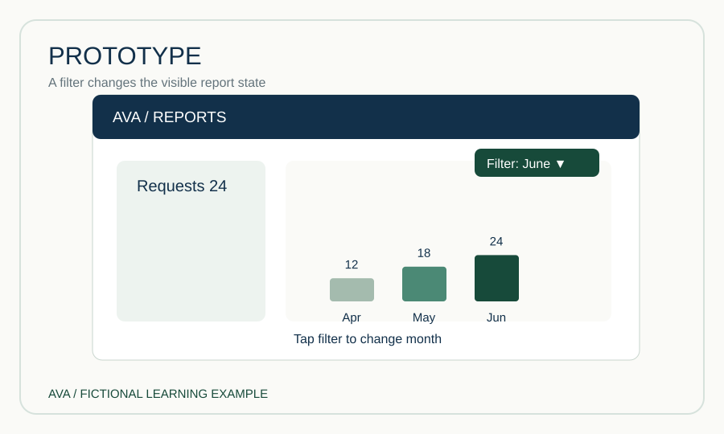

در تصویر، سه قاب از چپ به راست نشان می‌دهند چگونه یک ساختار ساده به ظاهر طراحی‌شده و سپس نمونه تعاملی تبدیل می‌شود. این‌ها الزاماً مراحل خطی و اجباری نیستند؛ گاهی تیم برای آزمون یک فرضیه، پروتوتایپ ساده را زودتر می‌سازد. مهم این است که نام خروجی را درست به کار ببریم تا توقع اشتباه ایجاد نشود.

**تمرین کوتاه:** اگر قرار است فقط جای دکمه‌های یک فرم را با تیم بررسی کنیم، آیا موکاپ کامل لازم است؟ توضیح بده چرا وایرفریم ممکن است کافی باشد.

---

## درس 6 — انتخاب تصویر؛ سؤال مهم‌تر از سلیقه است

### راهنمای خواندن تصاویر این درس

در نمونه Chart طول ستون‌ها به اعداد وابسته است. در Heatmap، رنگ خانه‌های جدول شدت مقدار را نشان می‌دهد. هیچ‌کدام فقط «رنگ‌های زیبا» نیستند: نمودار میله‌ای برای مقایسه مقدارها و نقشه حرارتی برای پیدا کردن الگو در ترکیب روز و ساعت است. اگر مقدار دقیق لازم باشد باید جدول داده هم ارائه شود.

**یک نکته برای استفاده در پروژه:** قبل از انتخاب تصویر جمله «می‌خواهم بفهمم که...» را کامل کن؛ پاسخ این جمله نوع نمودار را تعیین می‌کند.

وقتی داده را دریافت می‌کنیم، نباید از میان نمودارهای رنگارنگ یکی را صرفاً به دلیل جذابیت انتخاب کنیم. ابتدا باید سؤال مخاطب را مشخص کنیم. اگر سؤال «در طول زمان چه تغییری رخ داده؟» باشد، نمودار خطی معمولاً خواناست. اگر سؤال «کدام دسته بیشتر است؟» باشد، نمودار میله‌ای انتخاب مناسب‌تری است. اگر مخاطب عدد دقیق هر ردیف را می‌خواهد، جدول ضروری است.

نمودار دایره‌ای برای نشان‌دادن سهم چند بخش مثبت از یک کل قابل استفاده است؛ اما برای روند زمانی، داده منفی یا ده‌ها بخش کوچک معمولاً مناسب نیست. فلوچارت هم وقتی لازم است که مراحل و تصمیم‌ها را توضیح دهیم، نه مقدار فروش را. تصویر چهار سؤال «زمان؟ مقایسه؟ جزئیات؟ فرایند؟» را در کنار هم می‌گذارد تا انتخاب به مسئله وابسته بماند.

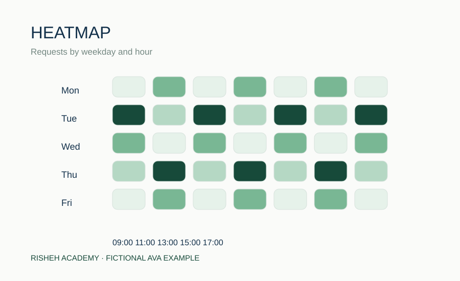

برای مثال آوا، داده سه ماهه ۱۲، ۱۸ و ۲۴ درخواست را می‌توان در نمودار خطی دید، اما همان اعداد باید در جدول یا توضیح قابل دسترسی هم وجود داشته باشند. نمودار باید عنوان، واحد، بازه و توضیح مناسب داشته باشد. اگر برچسب‌ها زیاد یا بلند شدند، بهتر است از جدول یا تقسیم محتوا استفاده کنیم، نه کوچک‌کردن بی‌پایان فونت.

**تمرین کوتاه:** برای «مقایسه تعداد درخواست‌های پنج کانال» یک نمایش انتخاب کن و بگو چرا نمودار دایره‌ای همیشه بهترین گزینه نیست.

---

## درس 7 — سلسله‌مراتب بصری؛ کاربر ابتدا چه چیزی را ببیند؟

### راهنمای خواندن تصاویر این درس

در تصویر Visual Hierarchy، جمله اصلی بزرگ‌تر و بالاتر از جزئیات است. چشم ابتدا نتیجه را می‌بیند و بعد به نمودار می‌رسد. در تصویر Progressive Disclosure، نمودار در بالا و بخش بازشدنی داده‌ها در پایین قرار گرفته است. این دو روش متفاوت‌اند: اولی اولویت توجه را می‌سازد، دومی سطح جزئیات را مدیریت می‌کند.

**یک نکته برای استفاده در پروژه:** اگر همه اجزای گزارش به یک اندازه برجسته باشند، مخاطب نمی‌فهمد کدام نتیجه مهم‌تر است.

فرض کن گزارشی ده کارت، چند جدول و سه نمودار دارد، اما همه عناصر با اندازه و رنگ یکسان دیده می‌شوند. کاربر باید خودش حدس بزند کدام بخش مهم است. **سلسله‌مراتب بصری (Visual Hierarchy)** یعنی با عنوان، اندازه، کنتراست، فاصله و جایگاه، ترتیب توجه را آگاهانه طراحی کنیم.

در یک گزارش خوب، مخاطب ابتدا نتیجه اصلی را می‌بیند، سپس شواهدی که آن نتیجه را پشتیبانی می‌کنند و در پایان جزئیات. تصویر این مسیر را از «پاسخ اصلی» به «شواهد» و «جزئیات» نشان می‌دهد. این ترتیب به معنای حذف اطلاعات نیست. **آشکارسازی تدریجی (Progressive Disclosure)** کمک می‌کند جزئیات تکمیلی را هنگام نیاز نمایش دهیم؛ مثلاً جدول کامل زیر نمودار در بخش بازشدنی قرار بگیرد.

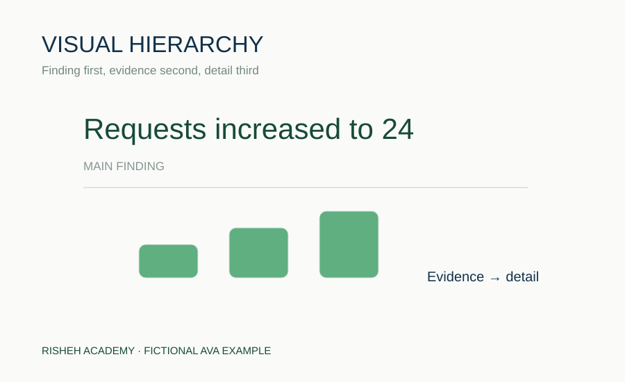

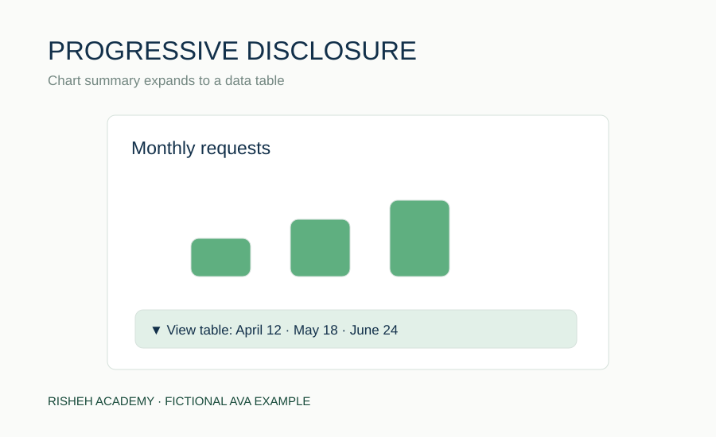

اشتباه رایج این است که برای مهم جلوه‌دادن همه چیز، همه کارت‌ها را بزرگ و پررنگ کنیم. در نتیجه هیچ‌چیز اولویت ندارد. همچنین نباید منبع داده یا هشدار ضروری را صرفاً برای خلوت‌شدن صفحه پنهان کنیم. طراحی حرفه‌ای یعنی توجه را هدایت کنیم، نه اینکه اطلاعات را از کاربر دریغ کنیم.

**تمرین کوتاه:** در گزارشی با عنوان، عدد اصلی، نمودار روند و جدول جزئیات، ترتیب مشاهده را پیشنهاد بده و دلیلش را بنویس.

---

## درس 8 — منشأ داده، دسترس‌پذیری و فارسی‌نویسی درست

### راهنمای خواندن تصاویر این درس

در تصویر Data Provenance، عدد ۲۴ بدون مسیر تولید نیست: از فایل منبع وارد مرحله بررسی می‌شود و سپس به شاخص تبدیل می‌شود. در Accessibility، یک نمودار و جدول داده کنار هم قرار دارند تا عددها بدون دیدن نمودار هم قابل دریافت باشند. در RTL، عنوان فارسی در جهت مناسب است اما URL همچنان چپ‌به‌راست خوانده می‌شود.

**یک نکته برای استفاده در پروژه:** هر بار که عددی را در گزارش می‌گذاری، از خود بپرس «آیا همکارم می‌تواند منبع و روش محاسبه آن را پیدا کند؟»

یک نمودار می‌تواند از نظر ظاهری بی‌نقص باشد اما همچنان قابل اعتماد نباشد. **منشأ داده (Data Provenance)** یعنی بدانیم هر عدد از چه منبعی آمده، در چه تاریخی استخراج شده و چه تغییراتی روی آن انجام شده است. اگر عدد ۲۴ از فایل نمونه آموزشی آمده، باید صریحاً بنویسیم ساختگی است؛ نباید آن را به‌عنوان عملکرد واقعی یک مشتری نشان دهیم.

**دسترس‌پذیری (Accessibility)** یعنی اطلاعات فقط برای کسی که نمودار رنگی را می‌بیند قابل استفاده نباشد. متن جایگزین معنادار، جدول داده، کنتراست کافی و قابلیت استفاده با صفحه‌کلید به افراد بیشتری کمک می‌کنند. تصویر چهار ایستگاه «منبع، بررسی، برچسب و جدول» را نشان می‌دهد؛ هرکدام بخشی از اعتمادپذیری گزارش‌اند.

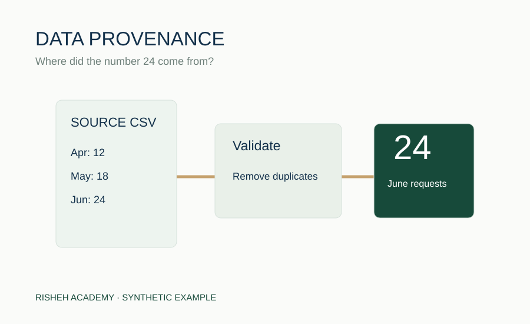

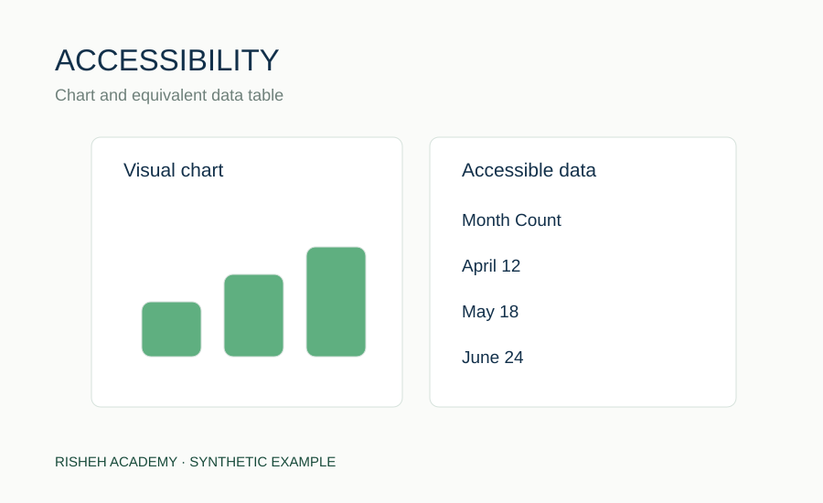

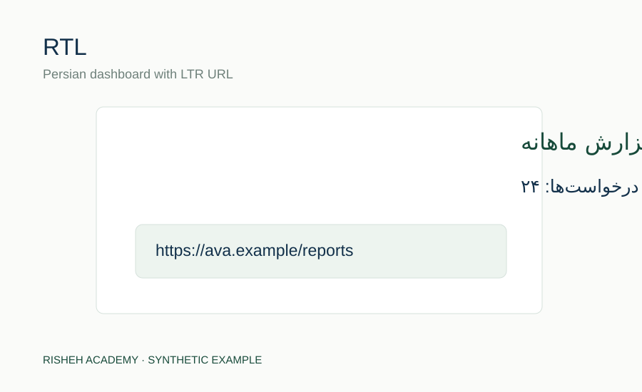

در محتوای فارسی، **RTL** به معنی راست‌به‌چپ بودن متن و چیدمان مناسب است، اما نباید کد، URL یا ترتیب منطقی محور زمان را بی‌دلیل وارونه کنیم. در PDF حتی اگر فایل بدون خطا ساخته شود، ممکن است حروف فارسی جدا یا علائم جابه‌جا شوند. بنابراین باید خروجی نهایی را با چشم بررسی کنیم.

**تمرین کوتاه:** برای نمودار «درخواست‌های ماهانه»، یک توضیح جایگزین بنویس که بدون دیدن تصویر هم روند را منتقل کند.

---

## درس 9 — Report IR؛ یک محتوا، چند خروجی

### راهنمای خواندن تصاویر این درس

در تصویر Report IR یک ورودی ساختاریافته به مدل مشترک می‌رسد و سپس به دو خروجی وب و PDF تبدیل می‌شود. این تصویر نمی‌گوید همه خروجی‌ها ظاهری یکسان دارند؛ می‌گوید منبع حقیقت و اعداد مشترک است. اگر عددی در JSON عوض شود، همه خروجی‌ها باید از همان نسخه به‌روز ساخته شوند.

**یک نکته برای استفاده در پروژه:** یک گزارش را دوبار با دست وارد نکن؛ تا حد ممکن از یک مدل داده معتبر برای همه خروجی‌ها استفاده کن.

اگر برای وب، Word و PDF هر بار گزارش را جداگانه بنویسیم، به‌مرور عنوان‌ها، اعداد یا منابع با هم متفاوت می‌شوند. **Report IR** مخفف Report Intermediate Representation یا «مدل میانی گزارش» است. در این روش، محتوای گزارش را در یک ساختار مشترک تعریف می‌کنیم و هر خروجی آن را به شیوه مناسب خودش نمایش می‌دهد.

برای مثال آوا، یک شیء داده می‌تواند عنوان، خلاصه، زبان، زمان تولید، منابع و بخش‌های گزارش را نگه دارد. بخش‌ها ممکن است از نوع متن، شاخص، جدول، نمودار یا فلو باشند. پیش از نمایش، ساختار و قواعد معنایی بررسی می‌شوند. سپس همان محتوا به صفحه React یا فایل سند تبدیل می‌شود. تصویر مسیر «داده → مدل میانی → وب/PDF» را ساده می‌کند.

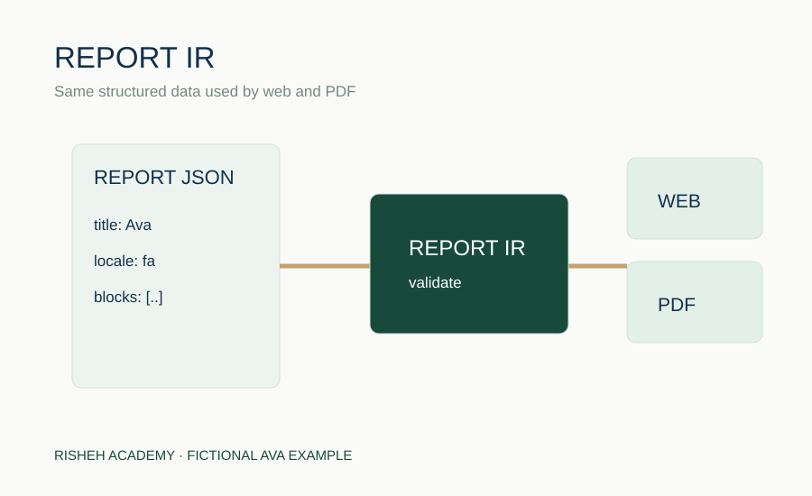

این معماری به معنی یکسان‌بودن ظاهری همه خروجی‌ها نیست. در وب می‌توان نمودار تعاملی داشت، اما در Word ممکن است تصویر نمودار و جدول داده مناسب‌تر باشد. مهم این است که **معنا و اعداد** ثابت بمانند. همچنین تولیدشدن فایل به‌تنهایی کیفیت رندر فارسی یا صحت فونت را اثبات نمی‌کند.

**تمرین کوتاه:** اگر عنوان گزارش در وب تغییر کرد ولی در PDF قدیمی ماند، استفاده از یک مدل میانی چگونه می‌تواند به رفع این ناسازگاری کمک کند؟

---

## درس 10 — کنترل کیفیت؛ از فایل ساخته‌شده تا خروجی قابل اعتماد

### راهنمای خواندن تصاویر این درس

در تصویر Visual QA دو حالت را کنار هم ببین: نسخه مورد انتظار و نسخه‌ای که نمودار از محدوده صفحه بیرون زده است. هر دو ممکن است از نظر کد قابل اجرا باشند، اما دومی برای کاربر خراب است. تصویر Regression Test نیز نشان می‌دهد خطای شناسه تکراری باید پس از اصلاح با تست دوباره رد شود.

**یک نکته برای استفاده در پروژه:** برای تحویل گزارش، اسکرین‌شات موبایل و صفحه PDF فارسی را واقعاً بازبینی کن؛ موفقیت Build کافی نیست.

آخرین مرحله فقط فشردن دکمه Build نیست. ممکن است کد TypeScript بدون خطا کامپایل شود، اما نمودار در موبایل از صفحه بیرون بزند یا PDF فارسی کلمات را نادرست نمایش دهد. به همین دلیل سه مفهوم را جدا می‌کنیم: **Code Review** یعنی بررسی منطق کد، **Automated Test** یعنی اجرای آزمون با نتیجه قابل اندازه‌گیری و **Visual QA** یعنی مشاهده و ارزیابی خروجی واقعی.

در تصویر، چهار حوزه کنترل دیده می‌شود: محتوا، موبایل، راست‌به‌چپ و فایل خروجی. در کنترل محتوا باید اعداد و منابع را بررسی کنیم. در موبایل باید مطمئن شویم جدول‌ها و برچسب‌ها بریده نمی‌شوند. در فارسی باید اتصال حروف، علائم و جهت خواندن را ببینیم. در خروجی سند باید صفحات، نمودارها و لینک‌ها را کنترل کنیم.

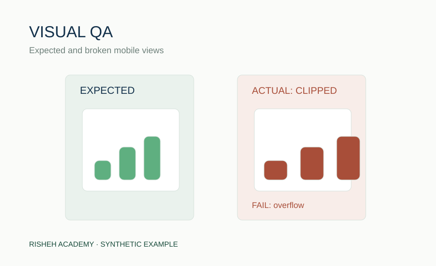

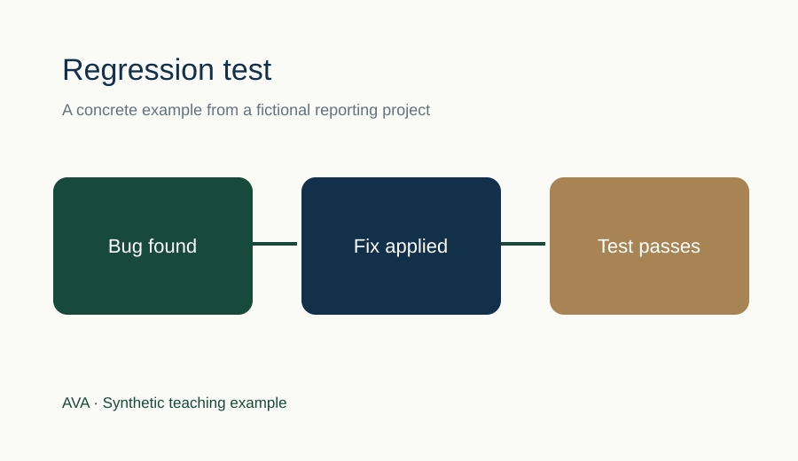

وقتی خطایی پیدا شد، گزارش آن باید قابل بازتولید باشد: روی چه نسخه و دستگاهی رخ داده، مراحل ایجاد خطا چه بوده، چه چیزی انتظار می‌رفت و واقعاً چه اتفاقی افتاده است. **تست رگرسیون** کمک می‌کند خطای اصلاح‌شده دوباره برنگردد. هیچ‌کدام از این کارها با صرفاً نوشتن «ممیزی انجام شد» جایگزین نمی‌شوند.

**تمرین کوتاه:** اگر فایل PDF ساخته می‌شود اما جدول صفحه دوم بریده است، چرا نتیجه Build موفق برای تأیید انتشار کافی نیست؟

---

## پس از پایان دوره چه کنیم؟

اگر عضو تیم طراحی یا مدیریت پروژه هستی، [کاربرگ تمرین](WORKBOOK_FA.md) را با توضیح دلیل پاسخ‌ها حل کن. اگر توسعه‌دهنده هستی، [راهنمای پیاده‌سازی](DEVELOPER_GUIDE_FA.md) را دنبال کن و با داده ساختگی یک گزارش React بساز. برای بررسی کیفیت خروجی، [دفترچه QA](QA_HANDBOOK_FA.md) را بخوان. واژه‌های تخصصی بیشتر در [فرهنگ اصطلاحات](GLOSSARY_FA.md) با مثال توضیح داده شده‌اند.

**نکته انتشار:** محتوای آموزشی آماده مطالعه است؛ اما استفاده از کد خروجی PDF و Word در پروژه مشتری همچنان به تست واقعی و بررسی رندر فارسی نیاز دارد.
