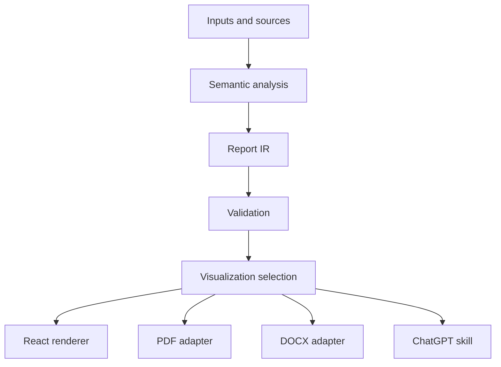

# Architecture / معماری

## Contracts
- Report IR is versioned and must be validated before export.
- Source references are stable IDs; never invent citations.
- Renderer implementations must preserve meaning when interactivity is unavailable.
- Charts in documents fall back to accessible tabular data in the current adapter.
- Locale is explicit; Persian output uses RTL at the web container level.

## ADR-001
Use a platform-neutral JSON report structure to separate semantics from rendering.

## ADR-002
Use React for browser rendering; document adapters use independent rendering libraries.

## Limitations
PDF font embedding and true Persian shaping are not configured in this foundation; do not advertise production-ready Persian PDFs. Browser chart responsiveness depends on container dimensions. Chart data must be numeric.
