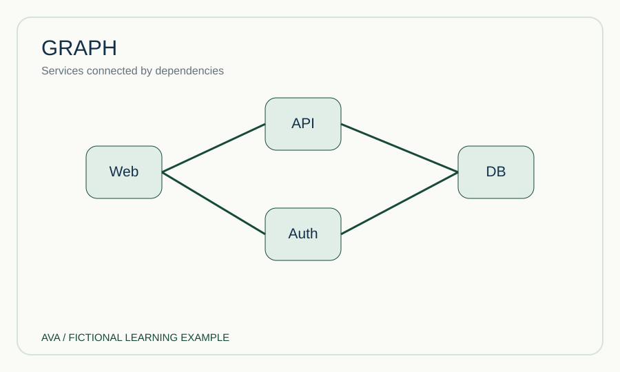
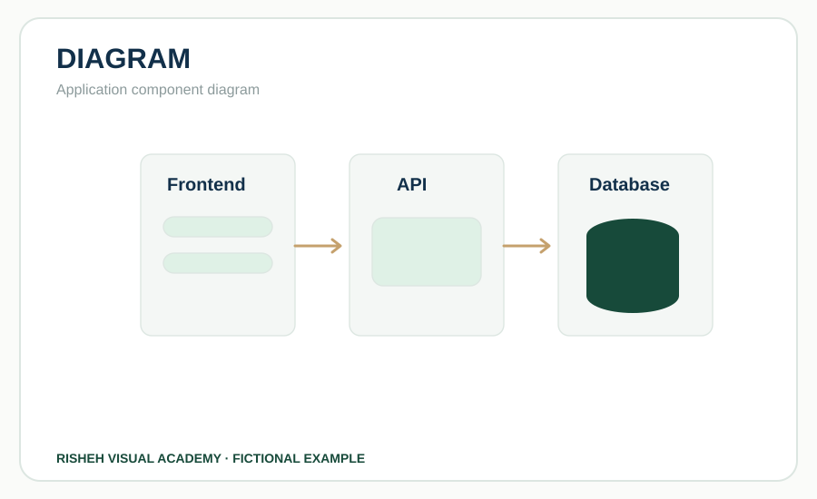
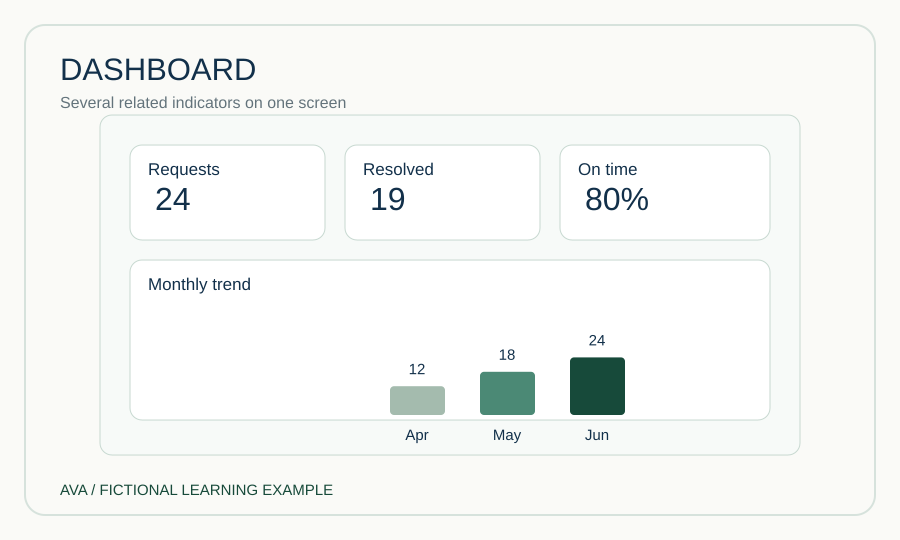
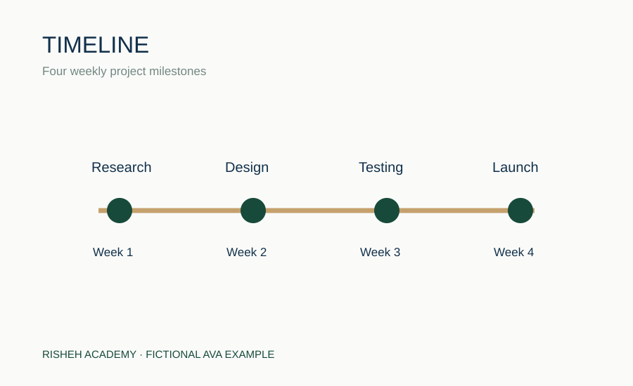
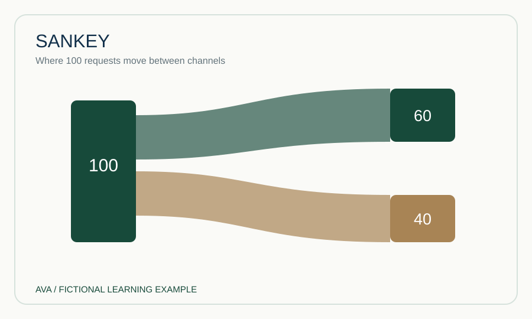
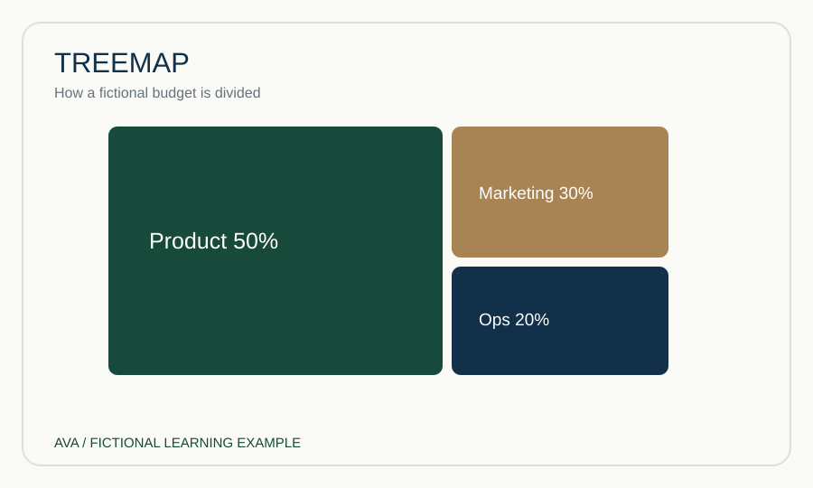
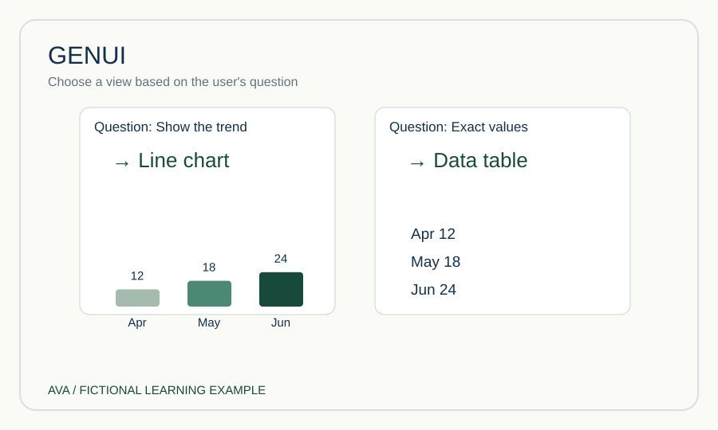
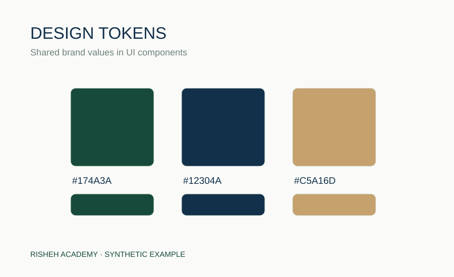

# فرهنگ اصطلاحات تشریحی طراحی و گزارش‌دهی

این واژه‌نامه برای گفت‌وگوی مشترک طراح، توسعه‌دهنده، مدیر پروژه و تیم محتواست. هر مدخل شامل **نمونه تصویری، تعریف، مثال، تفاوت و خطای رایج** است. تصویرها شکل واقعی‌نمای خروجی را نشان می‌دهند، نه صرفاً چند کادر با نام اصطلاح. تمام مثال‌ها ساختگی‌اند.

## ۱. Brief — بریف

در این تصویر، شکل قابل مشاهده این مفهوم را در یک نمونه ساختگی می‌بینی. به اجزا، اعداد و ارتباط‌های داخل نمونه دقت کن و سپس توضیح زیر را بخوان.

**چیست؟** تعریف روشن مسئله، مخاطب، هدف، محدوده، ورودی و معیار موفقیت پیش از طراحی. **مثال:** مدیر محصول می‌خواهد روند درخواست‌های سه‌ماهه را بفهمد. **با چه چیزی فرق دارد؟** بریف مسئله را مشخص می‌کند؛ وایرفریم چیدمان راه‌حل را. **اشتباه:** «طرح شیک می‌خواهیم» بریف کامل نیست.

## ۲. Blueprint — نقشه کلان

در این تصویر، شکل قابل مشاهده این مفهوم را در یک نمونه ساختگی می‌بینی. به اجزا، اعداد و ارتباط‌های داخل نمونه دقت کن و سپس توضیح زیر را بخوان.

**چیست؟** نمایی از اجزا، ارتباطات و توالی کلان سیستم یا تجربه. **مثال:** منبع داده → اعتبارسنجی → گزارش → خروجی PDF. **تفاوت:** معماری/بلوپرینت ارتباطات را نشان می‌دهد؛ موکاپ ظاهر صفحه را. **اشتباه:** نامیدن هر طرح صفحه به‌عنوان بلوپرینت.

## ۳. Chart — نمودار داده

در این تصویر، شکل قابل مشاهده این مفهوم را در یک نمونه ساختگی می‌بینی. به اجزا، اعداد و ارتباط‌های داخل نمونه دقت کن و سپس توضیح زیر را بخوان.

**چیست؟** نمایش دیداری مقادیر و الگوهای داده. **مثال:** تعداد درخواست در هر ماه. **تفاوت:** چارت معمولاً متکی به داده است؛ دیاگرام می‌تواند صرفاً روابط مفهومی را نشان دهد. **اشتباه:** انتخاب نمودار بدون سؤال تحلیلی.

## ۴. Graph — گراف

در این تصویر، شکل قابل مشاهده این مفهوم را در یک نمونه ساختگی می‌بینی. به اجزا، اعداد و ارتباط‌های داخل نمونه دقت کن و سپس توضیح زیر را بخوان.

**چیست؟** در آمار، نمودار مختصات؛ در علوم کامپیوتر، شبکه‌ای از گره‌ها و یال‌ها. **مثال:** شبکه وابستگی سرویس‌ها یک Graph است. **تفاوت:** Graph شبکه‌ای الزاماً نمودار کمی نیست. **اشتباه:** فرض اینکه همه کاربردهای Graph یک معنا دارند.

## ۵. Diagram — دیاگرام

در این تصویر، شکل قابل مشاهده این مفهوم را در یک نمونه ساختگی می‌بینی. به اجزا، اعداد و ارتباط‌های داخل نمونه دقت کن و سپس توضیح زیر را بخوان.

**چیست؟** نمایش شماتیک ساختار، رابطه یا فرایند. **مثال:** ارتباط Frontend، API و پایگاه داده. **تفاوت:** فلوچارت یک نوع خاص از دیاگرام است. **اشتباه:** استفاده از دیاگرام برای مقایسه دقیق اعداد.

## ۶. Flowchart — فلوچارت

در این تصویر، شکل قابل مشاهده این مفهوم را در یک نمونه ساختگی می‌بینی. به اجزا، اعداد و ارتباط‌های داخل نمونه دقت کن و سپس توضیح زیر را بخوان.

**چیست؟** دیاگرام مراحل و انشعاب‌های تصمیم. **مثال:** درخواست ثبت شد → اطلاعات کامل است؟ → بله/خیر. **تفاوت:** تایم‌لاین بر زمان تمرکز دارد؛ فلوچارت بر منطق مسیر. **اشتباه:** حذف شاخه‌های «خیر» و «خطا».

## ۷. Wireframe — وایرفریم

در این تصویر، شکل قابل مشاهده این مفهوم را در یک نمونه ساختگی می‌بینی. به اجزا، اعداد و ارتباط‌های داخل نمونه دقت کن و سپس توضیح زیر را بخوان.

**چیست؟** اسکلت ساختاری صفحه پیش از طراحی نهایی. **مثال:** جای فیلتر، نمودار و جدول در داشبورد. **تفاوت:** موکاپ جزئیات بصری بیشتری دارد. **اشتباه:** قضاوت درباره هویت بصری از روی وایرفریم خاکستری.

## ۸. Mockup — موکاپ

در این تصویر، شکل قابل مشاهده این مفهوم را در یک نمونه ساختگی می‌بینی. به اجزا، اعداد و ارتباط‌های داخل نمونه دقت کن و سپس توضیح زیر را بخوان.

**چیست؟** نمایش نزدیک به ظاهر نهایی با رنگ، فونت و تصاویر. **مثال:** صفحه داشبورد داخل قاب لپ‌تاپ. **تفاوت:** پروتوتایپ رفتار را قابل آزمایش می‌کند. **اشتباه:** فرض اینکه موکاپ زیبا یعنی رابط پیاده‌سازی‌شده است.

## ۹. Prototype — پروتوتایپ

در این تصویر، شکل قابل مشاهده این مفهوم را در یک نمونه ساختگی می‌بینی. به اجزا، اعداد و ارتباط‌های داخل نمونه دقت کن و سپس توضیح زیر را بخوان.

**چیست؟** نمونه قابل آزمایش تعامل، از ساده تا نزدیک محصول نهایی. **مثال:** کلیک روی فیلتر و مشاهده تغییر صفحه. **تفاوت:** موکاپ می‌تواند کاملاً ایستا باشد. **اشتباه:** یکی گرفتن نمونه نمایشی با نرم‌افزار آماده تولید.

## ۱۰. Dashboard — داشبورد

در این تصویر، شکل قابل مشاهده این مفهوم را در یک نمونه ساختگی می‌بینی. به اجزا، اعداد و ارتباط‌های داخل نمونه دقت کن و سپس توضیح زیر را بخوان.

**چیست؟** نمای یکپارچه شاخص‌ها برای پایش و تصمیم‌گیری. **مثال:** تعداد درخواست، روند، وضعیت خطا. **تفاوت:** گزارش می‌تواند توضیح تحلیلی طولانی داشته باشد؛ داشبورد بیشتر برای پایش سریع است. **اشتباه:** پرکردن صفحه با نمودارهای نامرتبط.

## ۱۱. KPI — شاخص کلیدی عملکرد

در این تصویر، شکل قابل مشاهده این مفهوم را در یک نمونه ساختگی می‌بینی. به اجزا، اعداد و ارتباط‌های داخل نمونه دقت کن و سپس توضیح زیر را بخوان.

**چیست؟** معیار سنجش پیشرفت به سمت هدف مشخص. **مثال:** درصد درخواست‌های پاسخ‌داده‌شده در زمان هدف. **تفاوت:** هر Metric یا عدد، KPI نیست. **اشتباه:** نمایش عدد بدون هدف، بازه و واحد.

## ۱۲. Scorecard — کارت امتیاز

در این تصویر، شکل قابل مشاهده این مفهوم را در یک نمونه ساختگی می‌بینی. به اجزا، اعداد و ارتباط‌های داخل نمونه دقت کن و سپس توضیح زیر را بخوان.

**چیست؟** مقایسه عملکرد با هدف یا معیار. **مثال:** هدف ۳۰، عملکرد ۲۴، اختلاف ۶. **تفاوت:** KPI یک معیار است؛ Scorecard معمولاً مجموعه‌ای از معیارها و اهداف را نمایش می‌دهد. **اشتباه:** نمایش امتیاز بدون روش محاسبه.

## ۱۳. Timeline — خط زمانی

در این تصویر، شکل قابل مشاهده این مفهوم را در یک نمونه ساختگی می‌بینی. به اجزا، اعداد و ارتباط‌های داخل نمونه دقت کن و سپس توضیح زیر را بخوان.

**چیست؟** ترتیب رخدادها روی محور زمان. **مثال:** کشف مسئله، طراحی، تست، انتشار. **تفاوت:** فلوچارت الزاماً زمان‌محور نیست. **اشتباه:** استفاده از فاصله‌های بصری مساوی برای مدت‌های بسیار متفاوت بدون توضیح.

## ۱۴. Sankey — نمودار سنکی

در این تصویر، شکل قابل مشاهده این مفهوم را در یک نمونه ساختگی می‌بینی. به اجزا، اعداد و ارتباط‌های داخل نمونه دقت کن و سپس توضیح زیر را بخوان.

**چیست؟** نمایش جریان بین دسته‌ها که پهنای مسیر نشان‌دهنده مقدار است. **مثال:** جریان ورودی درخواست‌ها بین کانال‌ها. **تفاوت:** فلوچارت منطق مسیر را نشان می‌دهد، نه حجم جریان. **اشتباه:** استفاده از پهنای تزئینی بدون داده واقعی.

## ۱۵. Heatmap — نقشه حرارتی

در این تصویر، شکل قابل مشاهده این مفهوم را در یک نمونه ساختگی می‌بینی. به اجزا، اعداد و ارتباط‌های داخل نمونه دقت کن و سپس توضیح زیر را بخوان.

**چیست؟** نمایش شدت مقدار با رنگ در ماتریس یا فضا. **مثال:** تعداد درخواست در روزهای هفته و ساعت‌ها. **تفاوت:** جدول اعداد دقیق‌تر است. **اشتباه:** استفاده از رنگ بدون راهنما یا جایگزین متنی.

## ۱۶. Treemap — نقشه درختی

در این تصویر، شکل قابل مشاهده این مفهوم را در یک نمونه ساختگی می‌بینی. به اجزا، اعداد و ارتباط‌های داخل نمونه دقت کن و سپس توضیح زیر را بخوان.

**چیست؟** نمایش بخش‌های سلسله‌مراتبی با مستطیل‌هایی متناسب با مقدار. **مثال:** سهم گروه‌های هزینه از کل. **تفاوت:** برای خواندن عدد دقیق، جدول مناسب‌تر است. **اشتباه:** مقایسه مساحت‌های نزدیک بدون برچسب.

## ۱۷. Report IR — مدل میانی گزارش

در این تصویر، شکل قابل مشاهده این مفهوم را در یک نمونه ساختگی می‌بینی. به اجزا، اعداد و ارتباط‌های داخل نمونه دقت کن و سپس توضیح زیر را بخوان.

**چیست؟** قرارداد داده‌ای که محتوای گزارش را از شیوه نمایش جدا می‌کند. **مثال:** یک شیء JSON با title، blocks و sources. **تفاوت:** Report IR خودش PDF یا صفحه React نیست. **اشتباه:** قراردادن منطق ظاهری مخصوص یک کانال در داده اصلی.

## ۱۸. GenUI — رابط تولیدشده متناسب با محتوا

در این تصویر، شکل قابل مشاهده این مفهوم را در یک نمونه ساختگی می‌بینی. به اجزا، اعداد و ارتباط‌های داخل نمونه دقت کن و سپس توضیح زیر را بخوان.

**چیست؟** ساخت یا انتخاب اجزای رابط متناسب با درخواست و داده، در محیطی که چنین قابلیت‌هایی را پشتیبانی می‌کند. **مثال:** انتخاب جدول یا نمودار بر اساس سؤال. **تفاوت:** GenUI نام یک نمودار خاص نیست. **اشتباه:** فرض اینکه هر خروجی دارای تعامل یا قابلیت ذخیره‌سازی است.

## ۱۹. Progressive Disclosure — آشکارسازی تدریجی

در این تصویر، شکل قابل مشاهده این مفهوم را در یک نمونه ساختگی می‌بینی. به اجزا، اعداد و ارتباط‌های داخل نمونه دقت کن و سپس توضیح زیر را بخوان.

**چیست؟** نمایش جزئیات در زمان نیاز، بدون پنهان‌کردن اطلاعات حیاتی. **مثال:** نمایش خلاصه نمودار و بازشدن جدول داده با کلیک. **تفاوت:** حذف اطلاعات نیست؛ مدیریت سطح جزئیات است. **اشتباه:** پنهان‌کردن واحد، هشدار یا منبع ضروری.

## ۲۰. Visual Hierarchy — سلسله‌مراتب بصری

در این تصویر، شکل قابل مشاهده این مفهوم را در یک نمونه ساختگی می‌بینی. به اجزا، اعداد و ارتباط‌های داخل نمونه دقت کن و سپس توضیح زیر را بخوان.

**چیست؟** هدایت توجه با اندازه، کنتراست، فاصله و ترتیب. **مثال:** نتیجه اصلی در بالا، شواهد زیر آن. **تفاوت:** زیبایی بصری به‌تنهایی کافی نیست؛ باید اولویت معنایی را منتقل کند. **اشتباه:** یکسان‌بودن تأکید همه عناصر.

## ۲۱. Data Provenance — منشأ داده

در این تصویر، شکل قابل مشاهده این مفهوم را در یک نمونه ساختگی می‌بینی. به اجزا، اعداد و ارتباط‌های داخل نمونه دقت کن و سپس توضیح زیر را بخوان.

**چیست؟** ثبت منبع، زمان، تبدیل و مسیر رسیدن داده به ادعا. **مثال:** شمار درخواست از فایل ساختگی در تاریخ معین، پس از حذف ردیف‌های تکراری. **تفاوت:** صرفاً نوشتن نام یک سایت، منشأ کامل نیست. **اشتباه:** ارائه عدد بدون امکان پیگیری.

## ۲۲. Accessibility — دسترس‌پذیری

در این تصویر، شکل قابل مشاهده این مفهوم را در یک نمونه ساختگی می‌بینی. به اجزا، اعداد و ارتباط‌های داخل نمونه دقت کن و سپس توضیح زیر را بخوان.

**چیست؟** طراحی برای استفاده با صفحه‌خوان، صفحه‌کلید، بزرگ‌نمایی و نیازهای متنوع. **مثال:** جدول داده جایگزین نمودار و برچسب معنادار. **تفاوت:** فقط کنتراست رنگ نیست. **اشتباه:** انتقال وضعیت تنها با رنگ.

## ۲۳. RTL — راست‌به‌چپ

در این تصویر، شکل قابل مشاهده این مفهوم را در یک نمونه ساختگی می‌بینی. به اجزا، اعداد و ارتباط‌های داخل نمونه دقت کن و سپس توضیح زیر را بخوان.

**چیست؟** جهت خواندن و چیدمان محتوای فارسی. **مثال:** عنوان فارسی راست‌چین، اما URL و قطعه کد با جهت طبیعی خود. **تفاوت:** RTL به معنای وارونه‌کردن تمام نمودارها نیست. **اشتباه:** جابه‌جایی اشتباه اعداد و علائم در متن ترکیبی.

## ۲۴. Design Tokens — توکن‌های طراحی

در این تصویر، شکل قابل مشاهده این مفهوم را در یک نمونه ساختگی می‌بینی. به اجزا، اعداد و ارتباط‌های داخل نمونه دقت کن و سپس توضیح زیر را بخوان.

**چیست؟** مقادیر نام‌گذاری‌شده رنگ، فاصله، شعاع و تایپوگرافی برای سازگاری رابط‌ها. **مثال:** رنگ سبز اصلی ریشه `#174A3A`. **تفاوت:** توکن یک مقدار قابل استفاده مجدد است، نه یک کامپوننت کامل. **اشتباه:** قراردادن رنگ‌های متفاوت و تکراری در هر صفحه.

## ۲۵. Visual QA — کنترل کیفیت بصری

در این تصویر، شکل قابل مشاهده این مفهوم را در یک نمونه ساختگی می‌بینی. به اجزا، اعداد و ارتباط‌های داخل نمونه دقت کن و سپس توضیح زیر را بخوان.

**چیست؟** بررسی خروجی رندرشده برای بریدگی، فاصله، متن، رنگ و واکنش‌گرایی. **مثال:** مشاهده PDF فارسی و اسکرین‌شات موبایل. **تفاوت:** TypeScript بدون خطا، کیفیت بصری را تضمین نمی‌کند. **اشتباه:** تأیید بدون مشاهده خروجی.

## ۲۶. Regression Test — تست رگرسیون

در این تصویر، شکل قابل مشاهده این مفهوم را در یک نمونه ساختگی می‌بینی. به اجزا، اعداد و ارتباط‌های داخل نمونه دقت کن و سپس توضیح زیر را بخوان.

**چیست؟** تستی برای جلوگیری از بازگشت خطایی که قبلاً رفع شده است. **مثال:** رد شناسه تکراری منابع. **تفاوت:** با تست اکتشافی انسانی متفاوت است. **اشتباه:** نوشتن تست بدون اجرای آن.

## ادامه یادگیری
[دوره تشریحی](ACADEMY_FA.md) · [کاربرگ تمرین](WORKBOOK_FA.md) · [راهنمای تیم](START_HERE_FA.md)
